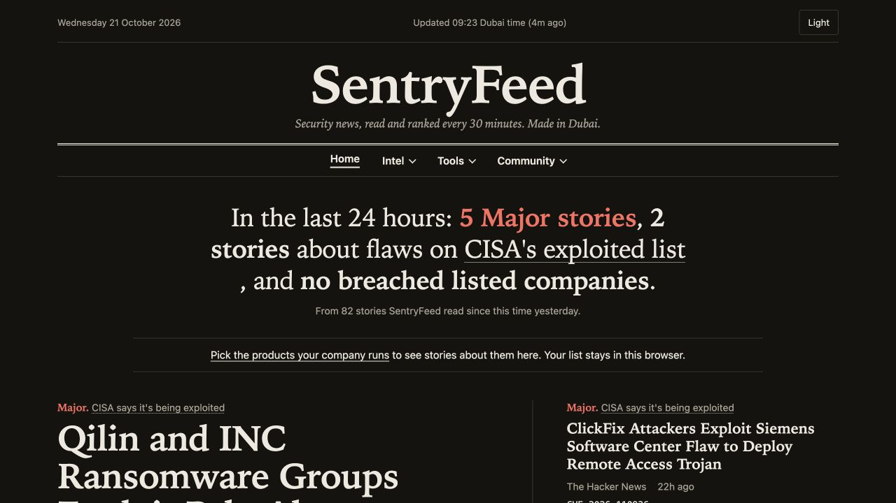

# SentryFeed

**Security news, read and ranked. Made in Dubai.**

A personal cybersecurity project by **Haseeb Ashfaq**. SentryFeed turns security reporting into a daily briefing: what happened, which flaws attackers are exploiting, and what deserves attention first.

[Visit SentryFeed](https://sentryfeed.vercel.app/) · [Read the writeup](WRITEUP.md) · [Technical guide](docs/project-guide.md)

## What you can do

- **Catch up quickly.** Read grouped stories, filter by severity, and follow the products you use.
- **Prioritise patches.** Compare exploitation evidence, CVSS and EPSS, with visible reasons behind the ranking.
- **Follow the Gulf.** Explore GCC reporting, regional trends and clearly labelled ransomware claims.
- **Investigate and learn.** Map campaign evidence to MITRE ATT&CK, explore source-reviewed breach connections, and find learning resources linked to vulnerability weaknesses.
- **Check the basics.** Inspect domain security, analyse email headers, check exposed passwords and review password-storage formats. Sensitive browser tools explain what stays local and what requests they make.

## How it works

Twelve RSS feeds → collection and enrichment on **GitHub Actions** → **Turso** SQL storage → **Flask and Jinja** on **Vercel** in Mumbai.

It began on a Raspberry Pi 3B. Moving repeated processing into the collector cut the measured first homepage response from **6.12 to 1.31 seconds** on that same Pi. The [writeup](WRITEUP.md) explains the measurements, migration and security tradeoffs.

The site aims to refresh about every 30 minutes. Sources can fail or be incomplete: ransomware entries are claims, scores are signals, and reported attribution is not proof.

Production page views use Vercel Web Analytics, with query strings and fragments removed before sending. No custom input or tool-result events are added. See the [analytics setup](docs/analytics.md).

## Suggestions and contributions

Ideas, bug reports and focused contributions are welcome through [GitHub issues](https://github.com/kaid0x/sentryfeed/issues) and pull requests. Please discuss larger changes first and read [CONTRIBUTING.md](CONTRIBUTING.md). Never include credentials, private reports or real password records.

## Ownership and use

SentryFeed is a personal, source-visible project, **not an open-source release under its current terms**. Viewing the code and contributing does not grant permission to deploy a replica, rebrand it, or reuse its code or assets in another project. See [LICENSE](LICENSE) for the limited contribution permission and exceptions.

Earlier versions were released under MIT; their existing permissions remain. GitHub’s platform rights and third-party licences also remain, including the [MITRE ATT&CK licence](static/attack-LICENSE.txt).

Built by [Haseeb Ashfaq](https://mhaseebashfaq.com).
