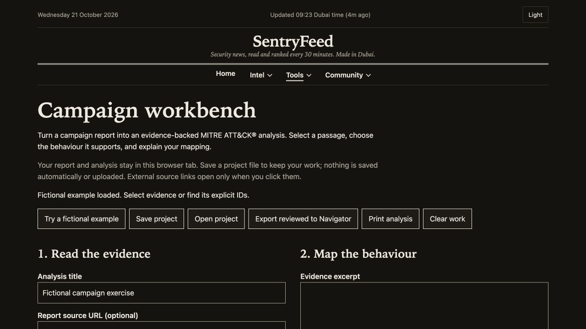

# SentryFeed: from a Raspberry Pi to a public threat-intelligence site

I built SentryFeed to make security news easier to act on. A headline can tell you that a vulnerability exists without explaining whether attackers are using it, whether it affects your software, or what you should prioritise.

SentryFeed brings those questions together. It collects security reporting, connects stories to vulnerability records and exploitation evidence, and presents the results as a readable briefing. I built it as a cybersecurity student in Dubai, with particular attention to small IT teams, students and readers in the Gulf.

[Explore the live site](https://sentryfeed.vercel.app/) · [View the source](https://github.com/kaid0x/sentryfeed)

*Live homepage captured on 21 October 2026. Headlines and counts are a snapshot of that day's feed, not independently verified findings.*

## Turning news into a useful briefing

The collector reads 12 RSS feeds, normalises articles and groups related reporting. It extracts CVE identifiers and adds information from NVD, CISA's Known Exploited Vulnerabilities catalogue and EPSS. Those sources answer different questions: technical severity, evidence of exploitation, and an estimated probability of exploitation.

I kept the prioritisation explainable. Stories display their severity and reason, while the patch queue shows the points behind its ranking. A reader can see why a flaw appears near the top instead of relying on an unexplained score.

The Gulf view collects regional reporting and aggregate ransomware claims. It distinguishes what news reports say from proven attribution, and labels ransomware leak-site entries as claims rather than confirmed incidents. Coverage depends on the sources being collected; the site is not a complete record of attacks in the region.

## Starting with limited hardware

The first version ran on a Raspberry Pi 3B at home, using Flask, Jinja and a SQLite database. The hardware encouraged a small dependency footprint: server-rendered pages, system fonts, no JavaScript build step, and a collector that runs as a job rather than staying resident.

I measured the system before deciding what to change. A saved snapshot recorded 229 MiB of used memory out of 905 MiB available, and 145 completed collector runs with no failures in the snapshot's seven-day log query. That is a historical observation, not an uptime guarantee.

The same snapshot also showed under-voltage and throttling flags. That mattered when interpreting performance: I was measuring this particular Pi in its actual condition, not establishing a benchmark for healthy Raspberry Pi hardware.

## Moving repeated work out of page requests

Some of the slowest work happened when a reader opened a page: tagging articles, grouping related stories and preparing page data. I moved repeated preparation into collection, saved grouped results, tagged new articles once and avoided unnecessary database writes. The Gulf page also limits grouping to relevant regional articles.

Saved before-and-after measurements on the Pi showed:

- Homepage: **6.12 seconds to 1.31 seconds**, approximately **79% less response time**.
- Gulf Cyber Pulse: **6.78 seconds to 0.89 seconds**, approximately **87% less response time**.

These were individual local HTTP measurements, not browser rendering times or statistical averages. Data and cache state can affect the result. They demonstrate the benefit observed during this optimisation exercise, not a universal performance claim.

## Moving beyond the home network

I retired the Pi on 12 October 2026 and split the application across three services:

- **GitHub Actions** runs collection and enrichment.
- **Turso** stores the shared SQL data in Mumbai.
- **Vercel** serves the Flask application from Mumbai.

The flow is straightforward: RSS and enrichment services feed the collector; the collector updates Turso; Flask reads the prepared data and renders pages for visitors. Keeping SQL avoided a database-model rewrite during the move.

The migration also exposed an operational problem: scheduled Actions runs were not reliably arriving at the expected times. I added a public check-in endpoint used by cron-job.org and UptimeRobot. It checks freshness and dispatch cooldowns before requesting a collector run. GitHub's schedule remains a backup. A visit does not automatically start another job, and the dispatch credential stays on the server.

This removed the dependency on my Pi remaining powered and connected at home. It did not remove dependencies altogether: the public site still relies on hosting, database availability, source APIs and valid credentials.

## Security decisions that shaped the features

Feed content and submissions are untrusted. Templates escape text, links are restricted to appropriate schemes, and the site uses a Content Security Policy with nonces for scripts and styles. Event submissions require command-line approval before publication; there is no public administrative login.

The domain checker needed a different boundary because it fetches user-selected destinations. Its fetch layer restricts requests to public addresses, pins the resolved address, limits ports and redirects, and applies size and time limits. This reduces the risk of turning the feature into a route to private services. Tests included private-address redirects, DNS rebinding and slow responses.

For sensitive analysis, I used the browser where possible. Pasted email headers and password-storage records are processed locally. The storage checker examines recognised formats, cost settings and salt observations, but does not crack passwords or declare an organisation secure. Its export contains aggregate findings rather than the supplied hashes or account identifiers.

## Making failures visible

One of the most useful lessons came from NVD integration. The old lookup handling treated HTTP 404 responses as missing CVEs. Testing showed that NVD could also return a 404 with an invalid-key message in a response header. A transport status alone was not enough to classify the result.

I changed the lookup path to preserve existing records on failed or malformed responses, recognise explicit authentication failures, validate returned records and recover older negative results gradually. Recovery uses the existing request budgets rather than deleting cached data in bulk.

I verified recovery through collector logs and read-only database checks. A green workflow was insufficient on its own: a job could finish while one upstream integration failed. That changed how I checked deployment health, from looking only at the final job status to checking the actual data outcome.

## From reading to analysis

Two additions help readers go further than consuming headlines.

**Learn this** connects supported CWE labels to reviewed practice resources and prevention guidance. It identifies the source of the weakness label and leaves broad or unsupported categories unmatched rather than guessing from a headline. Automated link checks help catch unreachable resources, while content suitability still needs human review.

The **campaign workbench** helps a reader turn a report into evidence-backed MITRE ATT&CK mappings. It uses a pinned Enterprise ATT&CK catalogue, requires evidence and rationale, and separates draft mappings from reviewed mappings. Only reviewed mappings enter the Navigator export. It does not automatically attribute a campaign to an actor.

*The screenshot uses the built-in fictional exercise. It contains no private report and does not represent a completed campaign analysis.*

## What I learned

SentryFeed taught me to treat source quality, failure handling and operational evidence as part of the product. Collecting more data is less useful if its meaning is unclear or an integration has silently stopped working.

The Pi made expensive work visible. Moving to hosted services made credential handling, database access patterns and scheduling failures more important. Across both environments, the same approach helped: measure the problem, make the smallest useful change, and check the result at the data and user-interface levels.

The result is a public project that combines security reporting, vulnerability prioritisation and practical analysis tools, with explanations and limits that readers can inspect.
